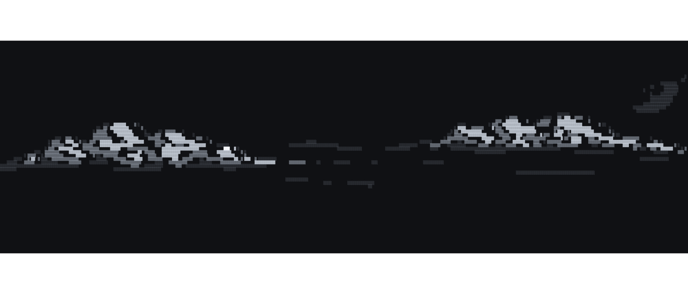

## Hey there! I'm Giap.

Once upon a time, there was a curious kid who installed Linux just because someone told him:

> "Linux is cool."

And that was the beginning of the end.

Since then, I've been messing around with code, terminals, servers, and all kinds of random stuff nobody asked me to touch.

**I use Arch btw.**

 

## Connect

 

## Contribution

  

 

 

